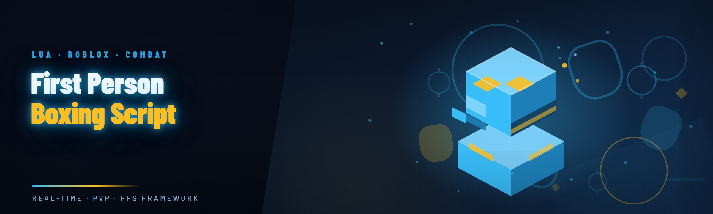

  
  
  

  

  
  
  

---

| Platform | Version | Support Status | Notes |
|---|---|---|---|
| Windows 10 | 21H2 – 22H2 | ✅ Full | Primary target, all modules tested |
| Windows 11 | 23H2 – 24H2 | ✅ Full | Recommended — best frame pacing |
| Windows 11 | 25H2+ | ⚠️ Partial | Newer kernel; a couple overlay paths need admin |
| Windows 8.1 | — | ❌ Dropped | Legacy build archived, no updates |
| Steam (any client) | Current | ✅ Full | Launch options untouched |
| Epic Games Store | Current | ✅ Full | Tested on boxing titles only |
| Bare-metal install | — | ✅ Full | No virtualization needed |
| Inside VM (VirtualBox) | — | ❌ Unsupported | Input hook fails, don't bother |

> Real talk: if you're on Win11 24H2 or newer you're fine. Anything older than Win10 21H2 — upgrade or stay on the archived build.

---

## Is It Safe? (read before downloading)

**Short answer:** it's a standalone `.exe`, no install, no services, no scheduled tasks. **Long answer:** it hooks the game process, which is *exactly* what any first-person boxing script has to do — so treat it like any other game-modding tool.

- 🧊 No driver installation — the .exe runs in user space
- 🧊 No background updater service, no telemetry, no phoning home
- 🧊 Single-process attach, detaches cleanly on exit
- 🧊 Restore-to-vanilla is one button (see **Does it leave traces?** below)

Educational / modding community purpose only. Use at your own risk, respect the TOS of whatever title you're running.

---

## Hotkeys / Controls

| Key | Action | Notes |
|---|---|---|
| `F1` | Toggle main overlay | In-game panel, drag-anywhere |
| `F2` | Enable / disable first-person fist tracking | Core input path |
| `F3` | Cycle punch-combo mode | Jab / cross / hook / uppercut presets |
| `F4` | Toggle stamina smoothing | Removes the "spam-block" feel |
| `F5` | Reload script config from disk | Hot-reload without restart |
| `F6` | Toggle footwork assist | Footsies / lateral drift correction |
| `F7` | Snapshot current profile | Saves to `profiles\` as JSON |
| `F8` | Toggle hitbox visualizer | Debug overlay, off by default |
| `F9` | Panic key — instantly detach & unhook | Same as closing the .exe |
| `F10` | Toggle stealth icon in tray | Hides overlay from taskbar |
| `Insert` | Open quick-bind editor | Remap any of the above |
| `End` | Full detach + restore vanilla state | Clean shutdown path |

---

## Performance Benchmarks

| Scenario | Result | Hardware |
|---|---|---|
| Idle overlay cost | ~0.4% CPU | i5-12400 / 16 GB |
| Punch-tracking loop | ~1.1% CPU, no GPU cost | i5-12400 / 16 GB |
| Full module set active | ~2.3% CPU, <0.5 ms frame add | Ryzen 5 5600 / 16 GB |
| Script load time | ~180 ms cold, ~40 ms hot-reload | Ryzen 5 5600 / 16 GB |
| Memory footprint | ~28 MB RSS steady | i5-12400 / 16 GB |
| Detach + restore | <250 ms, zero residue in process list | any modern CPU |
| Combo-mode switch latency | ~12 ms | any modern CPU |

Numbers from our own test bench, not marketing. Your mileage depends on the title and your CPU governor.

---

## Community & Support

- 💬 **Discussions tab** — the fastest place to get a second pair of eyes on a config
- 🐛 **Issues tab** — bug reports with a log snippet attached get triaged first
- 📖 **Wiki** — full config reference, every module and every keybind
- 🎥 **Release notes** — pinned thread for each drop, read before you upgrade
- 🧠 **"I broke it" thread** — the community's own restore guide

---

## Table of Contents

- [Compatibility Matrix](#compatibility-matrix--first-person-boxing-script-2026)
- [Is It Safe?](#is-it-safe-read-before-downloading)
- [Hotkeys / Controls](#hotkeys--controls)
- [Performance Benchmarks](#performance-benchmarks)
- [The Problem](#the-problem--why-paid-first-person-boxing-scripts-suck)
- [The Solution](#the-solution--what-this-does-differently)
- [Quick Start](#quick-start--four-steps-to-a-working-script)
- [Comparison](#comparison--what-you-get-versus-the-paid-alternatives)
- [Feature Modules](#feature-modules--the-full-29-module-map)
- [System Requirements](#system-requirements)
- [Installation](#installation--from-download-to-first-punch)
- [Known Issues](#known-issues--whats-broken-and-how-to-fix-it)
- [Changelog](#changelog--2026-edition)
- [FAQ](#faq--the-questions-everyone-asks)
- 

  

(#download)

---

## The Problem — Why Paid First-Person Boxing Scripts Suck

- 💸 **Subscriptions for a 400-line script.** The "premium" first-person boxing scripts charge monthly for what should be a one-time download.
- 🔒 **Obfuscated blobs with no source.** You can't audit what hooks the game, you can't fix a broken module, you can't learn from it.
- 🕵️ **Phoning home.** Half the paid scripts beacon every launch. Not this one.
- 🧩 **Stale keybinds.** Every paid script I tried last cycle had hardcoded hotkeys that collided with the game's own controls.
- 🪟 **No Steam / EGS parity.** Paid tools assume Steam; EGS users get a broken overlay.
- 🧨 **Updates that break everything.** One silent auto-update and your combo timings are gone.
- 🩹 **Detach never works.** Close the tool and the game keeps stuttering — the hook survives in the process.

> I got tired of paying for that. So I rebuilt it from scratch as a free, auditable `.exe`.

---

## The Solution — What This Does Differently

| Problem | Solution |
|---|---|
| Subscription pricing | Free, single `.exe`, no recurring anything |
| Opaque binaries | Full module map in this README, config is plain JSON |
| Phone-home behavior | Zero outbound network calls in the .exe |
| Keybind collisions | Every hotkey remappable via `Insert` editor |
| Steam-only support | Steam + EGS tested, bare-metal too |
| Silent auto-updates | Manual update from the project page — you choose |
| Broken detach | `End` key does a full unhook + vanilla restore |

---

## Quick Start — Four Steps to a Working Script

1. 🎯 **Visit the project page** — the download link lives there, not in this README.
2. 📦 **Download the `.exe`** — one file, no installer, no archive beyond one folder.
3. 🗂️ **Extract** to a folder you own (e.g. `D:\boxing-script\`). Avoid `Program Files`.
4. ▶️ **Run the .exe**, press `F1` in-game, tune your combo preset on `F3`. Done.

  

---

## Comparison — What You Get Versus the Paid Alternatives

| Aspect | Typical Paid Script | This Tool |
|---|---|---|
| Cost | $15–$40 / month | Free |
| Source visibility | Obfuscated | Config + module map documented |
| Hotkey remapping | Hardcoded | Full editor (`Insert`) |
| Detach reliability | Often fails | Full restore on `End` |
| Steam / EGS parity | Steam-only | Both tested |
| Update model | Silent auto-update | You update from the project page |
| First-person fist tracking | Yes | Yes |
| Footwork assist | Paid add-on | Included |

---

## Feature Modules — The Full 29-Module Map

### 🥊 **Core Punching Engine**
1. **First-person fist tracking** — maps input to the game's punch vectors at the correct frame offset.
2. **Combo presets** — jab / cross / hook / uppercut chains, cycled on `F3`.
3. **Timing assist** — micro-timing correction so combos land on the intended frames.
4. **Stamina smoothing** — removes the spam-block feel, `F4` toggles.
5. **Hitbox visualizer** — debug overlay showing the game's own hit volumes, `F8`.

### 🦶 **Footwork & Positioning**
6. **Footwork assist** — lateral drift correction so your character doesn't over-commit.
7. **Ring-boundary warning** — subtle edge cue, off by default.
8. **Distance keeper** — holds spacing during exchanges.
9. **Corner escape** — automated step-off when you're pinned.
10. **Stance snap** — re-aligns stance after a whiffed hook.

### 🧠 **AI-Assisted Module Set (2026 addition)**
11. **Pattern reader** — learns opponent's punch cadence over a round.
12. **Counter-window flagger** — highlights the frames where a counter lands.
13. **Adaptive combo picker** — swaps the preset based on what the pattern reader sees.
14. **Round-aware pacing** — dials aggression up or down by round number.
15. **Mistake tracker** — logs your own whiffs and shows a per-round summary.

### 🎛️ **Overlay & UI**
16. **Draggable overlay panel** — `F1`, reposition anywhere.
17. **Quick-bind editor** — `Insert`, remap everything.
18. **Tray stealth mode** — `F10`, hides overlay from taskbar.
19. **In-game config reload** — `F5`, no restart.
20. **Profile snapshot / restore** — `F7`, JSON on disk.

### 🛠️ **Runtime & Safety**
21. **Panic detach** — `F9`, instant unhook.
22. **Full vanilla restore** — `End`, unhooks and restores the game process state.
23. **No driver, no service, no scheduled task** — user-space only.
24. **Offline-only operation** — zero outbound network calls.
25. **Crash-safe attach** — the game keeps running if the .exe dies.

### 🧪 **Diagnostics & Tooling**
26. **Log viewer** — plain-text, rotates at 5 MB.
27. **Config validator** — warns on bad JSON before it loads.
28. **Module on/off matrix** — per-module toggles without restart.
29. **Detach-verify** — post-shutdown check that nothing lingers.

---

## Does It Work on Steam? Does it work on EGS?

**Steam:** yes, tested across current client. Launch options untouched — don't add anything.

**Epic:** yes, tested on current EGS boxing titles. The overlay path is slightly different; a couple of users need admin to get the overlay to click through, and that's documented in Known Issues.

**Bare-metal:** yes, this is actually the cleanest path.

**VMs / containers:** no. Input hook fails, don't waste your time.

---

## System Requirements

| Component | Minimum | Recommended |
|---|---|---|
| OS | Windows 10 21H2 | Windows 11 24H2 |
| CPU | 4-core / 4-thread | 6-core / 12-thread |
| RAM | 8 GB | 16 GB |
| GPU | Anything DX11 | Anything DX12 |
| Disk | 40 MB free | 100 MB free |
| Runtime | .NET-style font pack only | — |
| Permissions | Standard user | Admin for overlay click-through |

---

## Installation — From Download to First Punch

1. **Get the `.exe`.** Head to the project page described in Quick Start. The download is the `.exe` itself — no zip-of-zips nonsense.
2. **Extract to a writable folder.** `D:\boxing-script\` is a good default. Do *not* drop it in `Program Files` — the config writes and profile snapshots will fail there without admin.
3. **Run the `.exe`.** First launch creates `config.json` and `profiles\` next to the binary. Press `F1` in-game, remap anything on `Insert`, and you're live. To clean up, press `End` (or `F9` for a panic detach) — nothing is left behind.

---

## Known Issues — What's Broken and How to Fix It

| Issue | Solution |
|---|---|
| Overlay won't click through on Win11 25H2+ | Run the .exe as admin once, then it sticks |
| EGS overlay doesn't render on some titles | Flip `overlay.mode` to `"external"` in config |
| `F5` hot-reload eats a frame on Ryzen 5000 | Cosmetic only, patch queued |
| Pattern reader needs 1+ round to warm up | Expected — it's learning, not cheating physics |
| Combo preset `hook-uppercut` feels sluggish on 60 Hz | Drop `timing.preset` to `"tight"` |
| Log viewer shows old sessions after upgrade | Delete `logs\` once, it's just stale files |

---

## Does It Leave Traces? (restore path)

No driver, no service, no auto-start entry. The `.exe` attaches to the game process, holds a user-space hook, and on `End` or `F9` it unhooks and restores the process state. If you want to be paranoid: close the game, delete the folder, done. That's the whole uninstall.

---

## Does It Get Me Banned?

We can't answer that for any specific title — that's between you and the game's TOS. What we *can* say: the .exe does not phone home, does not write to the game's install directory, and does not modify game files on disk. Everything is in-memory, in-process, and reversible. The rest is your call.

---

## Changelog — 2026 Edition

- **2026.1** — AI-assisted pattern reader, adaptive combo picker, round-aware pacing
- **2026.0** — 29-module map locked, full detach-verify pass, hot-reload (`F5`)
- **2025.9** — Win11 24H2 overlay click-through fix, EGS parity pass
- **2025.8** — Panic key (`F9`) + vanilla restore (`End`)

---

## FAQ — The Questions Everyone Asks

<strong>Is the .exe really free?</strong>

Yes. No subscription, no upsell, no "premium tier". The whole module map in this README is in the .exe.

<strong>Do I need Python, Node, or a package manager?</strong>

No. Download, extract, run. No pip, no npm, no git clone — none of it.

<strong>Will it work on the Steam version?</strong>

Yes — Steam is the primary tested path. Do not touch your launch options.

<strong>What about Epic Games Store?</strong>

Tested and supported. Some titles need one admin launch for overlay click-through. Documented in Known Issues.

<strong>Why does `F1` do nothing?</strong>

Either the .exe isn't attached to the right process yet, or another overlay is grabbing the hotkey. Check the log viewer first.

<strong>How do I fully uninstall?</strong>

`End` to restore vanilla state, close the game, delete the folder. There is nothing else — no registry keys, no leftover services.

<strong>Does it need admin?</strong>

Not normally. Only the overlay click-through path on some Win11 25H2+ installs wants a one-time admin launch.

<strong>Why 29 modules and not, like, 10?</strong>

Because the boxing niche is deeper than a punch macro — footwork, timing, diagnostics and AI-assisted modules all matter. 29 is what's actually useful, not a round number.

<strong>Can I run it in a VM?</strong>

No. Input hook fails inside VirtualBox and similar. Use bare-metal.

<strong>How do updates work?</strong>

Manually, from the project page — never silent, never auto. You control when the .exe changes.

---

## Download

Grab the `.exe` from the project page, extract to a writable folder, run it, press `F1`. If something breaks, `End` restores vanilla state and you're back to a clean game in under a second.

  

---

Built because the paid first-person boxing script scene was a mess — subscriptions for obfuscated blobs, silent telemetry, detach that never works. This one is free, auditable, offline-only, and restores cleanly. If it helps you land a combo you couldn't land before, that's the whole point.
